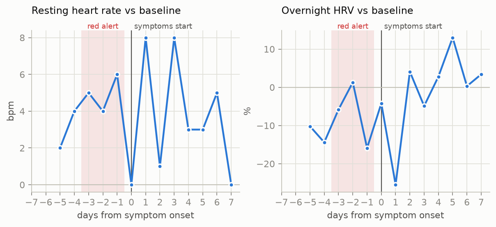
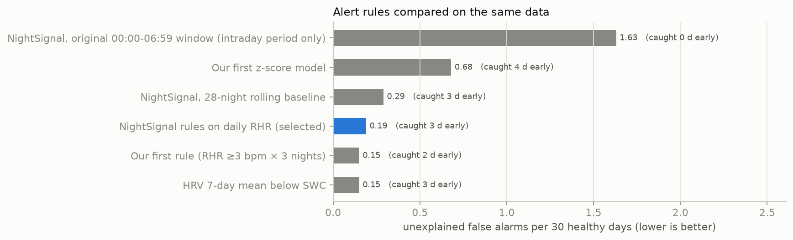
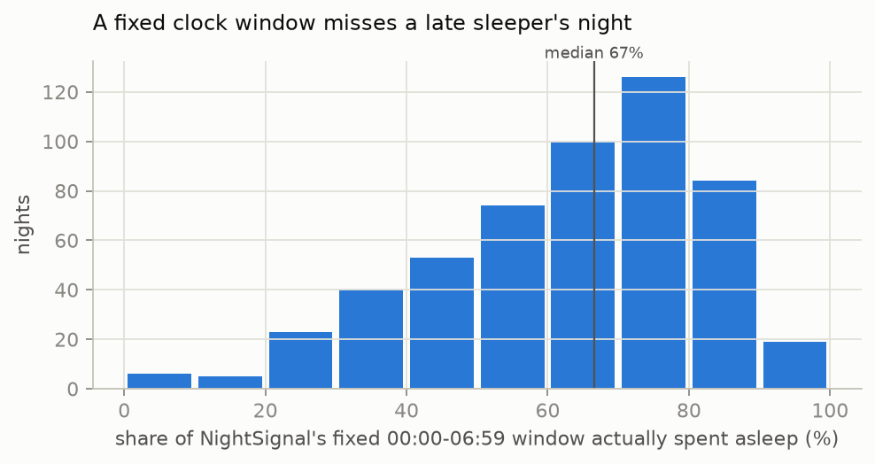
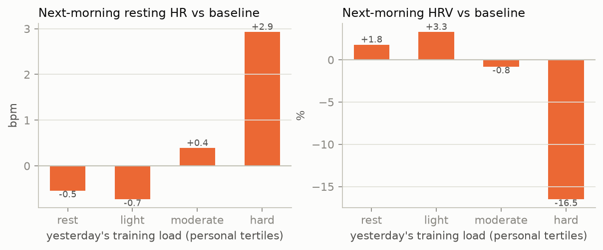
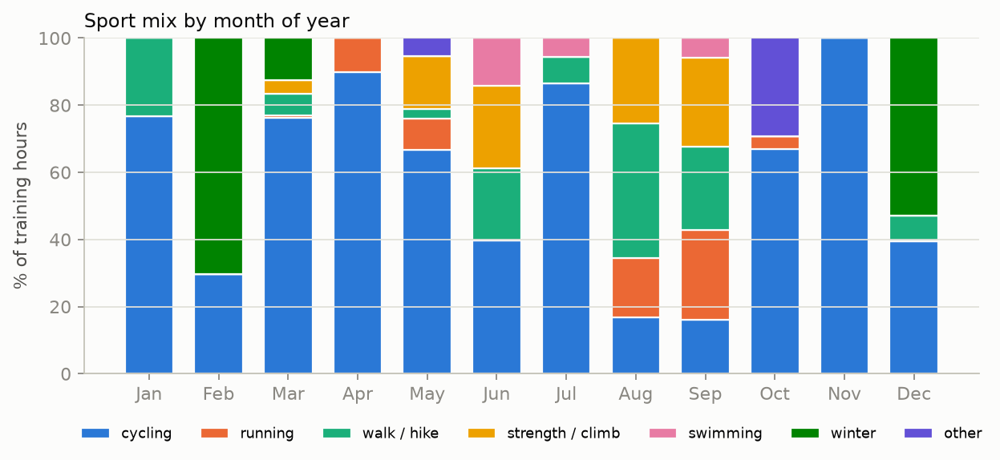

# Garmin Training Analytics

[](https://github.com/hakan-ay/garmin-training-analytics/actions/workflows/ci.yml)
[](https://garmin-training-analytics-i8srz9xojdxxbc8uedyref.streamlit.app)

**[Open the live demo](https://garmin-training-analytics-i8srz9xojdxxbc8uedyref.streamlit.app)** (synthetic data)

**Can a smartwatch tell you that you are getting sick before you feel it, without confusing illness with a hard training week?**

An end-to-end analytics project on wearable data: a SQL-first DuckDB pipeline, early-warning models built **only on published, peer-reviewed methods**, a validation against labelled events, and a dashboard that explains *why* a day is flagged.

> **Data:** the author's own Garmin data, about 21 months (~180 activities, ~650 nights): an n-of-1 self-tracking study. Locations and raw data are not published. Figures use relative days or month of year; the live dashboard shows the author's processed daily data with **every date shifted by an undisclosed number of weeks**, next to a **synthetic** demo athlete.

## Key findings

| | Finding | Why it matters |
|---|---|---|
| 1 | Resting heart rate was **4-6 bpm above baseline for the 4 nights before symptoms**; the alert fired **3 days before onset** | Early warning is possible from data a watch already collects |
| 2 | Applying the published NightSignal rules to the daily resting heart rate gives **~0.2 unexplained false alarms per 30 days**; the original fixed-window input gives **1.6** | How you feed a published algorithm matters as much as the algorithm |
| 3 | For a late sleeper only **67 % (median)** of the fixed 00:00-06:59 window is spent asleep | Clock-based algorithms fail for students and shift workers |
| 4 | After a hard training day, next-morning resting HR is **+2.9 bpm** and HRV **−16.5 %** | Training produces the same signature as illness, so it must be modelled as a confounder |
| 5 | The sport mix shifts strongly by season (cycling in spring/autumn, strength and hiking in summer, skiing in winter) | Load models must work across very different sports, hence heart-rate based TRIMP |



*Finding 1, event study around the logged illness (day 0 = first day of symptoms). Shaded: days with a red alert. n = 1 illness, so this shows the method working, not a statistical result.*



*Finding 2, unexplained false alarms per 30 healthy days on the same data. The three best rules are within one extra false alarm over the whole period; NightSignal is selected because it is a published, externally validated rule and flags earlier than our own first rule (3 vs 2 days).*

<p float="left">
  
  
</p>

*Findings 3 and 4. Left: share of NightSignal's fixed night window actually spent asleep. Right: next-morning deviation from baseline by yesterday's training load (personal tertiles of Banister TRIMP).*



*Finding 5, share of training hours per sport by month of year.*

## Methods

Every signal is based on a published method, and the thresholds are the ones defined in the original studies.

| Signal | Method | Source | File |
|---|---|---|---|
| **Resting heart rate (primary alert)** | NightSignal: nightly heart rate ≥ median of all previous nights +3 (yellow) / +4 (red), on 2 consecutive nights | Alavi et al., *Nature Medicine* 28:175 (2022) | `sql/07_nightsignal.sql` |
| HRV | 7-day rolling mean of lnRMSSD; personal normal range = baseline ± 0.5·SD (SWC) | Plews et al., *Eur J Appl Physiol* (2012); AIS HRV best-practice (2023) | `sql/08_hrv_resp_sleep.sql` |
| Respiration | Personal normal + 3 breaths/min | Natarajan et al., *npj Digit Med* 3:156 (2020) | `sql/08_hrv_resp_sleep.sql` |
| Sleep debt | 7-night average ≤ 6 hours → risk modifier | Prather et al., *SLEEP* 38:1353 (2015) | `sql/08_hrv_resp_sleep.sql` |
| Training load | Banister TRIMP; cross-checked with Edwards TRIMP | Banister (1991); Edwards (1993) | `sql/03_training_load.sql` |
| Load confounder | Foster monotony × weekly load = strain (personal 90th percentile); EWMA acute:chronic ratio > 1.5 | Foster, *MSSE* 30:1164 (1998); Williams et al., *BJSM* (2017) | `sql/03_training_load.sql` |

**Validated implementation.** `tests/test_nightsignal.py` runs Stanford's original `nightsignal.py` on its own sample data and compares it with our SQL: **identical** results on all 197 nights and 27 alert days (run in CI on every push). Banister and Edwards TRIMP agree across 162 activities (r = 0.99).

**Adaptation.** NightSignal's original input is the mean step-free heart rate between 00:00 and 06:59. For a late sleeper much of that window is spent awake (finding 3), so the same rules (baseline, thresholds, two-night logic) are applied to Garmin's daily resting heart rate. Both variants, plus a sleep-window variant, are kept and compared in `sql/analysis/a5_model_comparison.sql`.

**Why HRV does not raise illness alerts.** The Plews method was developed for training adaptation and overreaching, and the 7-day mean can stay low for weeks; as an illness alert it produced 64 "watch" days per year. It is used on the overload card and shown only as supporting evidence for illness.

**Confounders.** A deviation becomes an illness *alert* only when it is not explained by training (strain above the personal 90th percentile or EWMA ACWR > 1.5) or by a logged context event (travel, heat, alcohol, altitude…). Otherwise it is a *watch*.

**Limitations.** Only one illness is logged so far, so detection and lead time are case studies, not statistics; the false-alarm rate rests on ~600 healthy days. Garmin keeps minute-level heart rate for a limited time only. ACWR's ability to predict injury is debated (Impellizzeri 2020).

## Risk dashboard

```bash
uv run streamlit run app/dashboard.py        # author's data, demo scenarios, and your own data if you built it
```

One page for an athlete or coach: the **illness** and **overload / injury** risk for a selected day, **why** it is at that level, and **which publication** each piece of evidence is based on.

- **Status cards:** risk level (icon + label) with evidence sentences, e.g. *"Resting heart rate 57 bpm: +5 bpm above the personal baseline, 2 nights in a row [Alavi 2022] … the deviation is not explained by training."*
- **NightSignal chart:** resting heart rate, baseline and the +3 / +4 thresholds; nights above a threshold are marked yellow / red.
- **HRV chart:** 7-day lnRMSSD mean and personal normal range.
- **Load:** daily Banister TRIMP, EWMA acute:chronic ratio and Foster strain against the personal 90th percentile.
- **No hindsight bias:** by default only data up to the selected day is shown, i.e. what the model knew on that day.
- `?date=YYYY-MM-DD` links to a specific day.

The page has a **Data** switch:

- **Author's data:** the author's own processed daily data, exported by `src/export_public.py` with an allowlist of columns, every date shifted by a fixed undisclosed whole number of weeks (weekdays and seasons preserved) and free-text notes removed.
- **Demo scenarios:** a synthetic athlete (`src/make_synthetic.py`).
- **My data:** only on your own machine, with real dates.

The synthetic athlete contains three scenarios the models must separate; open each one directly in the [live demo](https://garmin-training-analytics-i8srz9xojdxxbc8uedyref.streamlit.app):

- [**Illness**](https://garmin-training-analytics-i8srz9xojdxxbc8uedyref.streamlit.app/?dataset=demo&date=2024-08-17): red alert 2 days before the logged onset
- [**Hard training block**](https://garmin-training-analytics-i8srz9xojdxxbc8uedyref.streamlit.app/?dataset=demo&date=2024-03-12): heart rate up, but the illness card stays on *watch* and the overload card is *high*
- [**Logged trip**](https://garmin-training-analytics-i8srz9xojdxxbc8uedyref.streamlit.app/?dataset=demo&date=2024-06-21): the same heart-rate signature, explained by the context log, so *watch*, not alert

CI asserts all three on every push.

## Activity data cleaning

Rules live in the `sql/00_sport_rules.sql` table, so changing a threshold is a data change, not a code change. No record is deleted: excluded activities stay in the `excluded_activities` view with their reason.

| Order | Rule | Reason |
|---|---|---|
| 1 | Same start time → keep the longest record | Duplicate sync |
| 2 | Manual entries are excluded | No sensor data |
| 3 | No heart rate data → excluded | All analyses rely on heart rate |
| 4 | Average HR outside 50-200, max > 220 or max < average → excluded | Physiologically impossible |
| 5 | Sport-specific minimum duration (cycling 10 min, skiing 30 min…) | Watch started by accident |
| 6 | Sport-specific minimum distance (cycling 2 km, running 1 km; none for swimming/mountaineering/strength) | GPS distance is unreliable in open water and on vertical terrain |
| 7 | Sport-specific speed range (cycling 8-55 km/h, running 2:30-10:00 min/km) | Watch not stopped, GPS spikes |
| 8 | Sport not in the rules table → `no_rule` | New sport types must not silently enter the analysis |

**Wellness data quality.** Resting heart rate is used only on nights the watch recorded sleep. On days it was not worn overnight, Garmin derives "resting HR" from daytime wear (65-85 bpm instead of ~50), which is not a valid input for overnight methods; these readings caused the largest false alarms before the rule was added.

Speed uses `moving_duration` for cycling/running (excludes breaks) and total duration otherwise, because Garmin's moving time is unreliable for mountaineering. Raw sport types are merged into 8 `sport_group`s with a separate `is_indoor` flag.

## Pipeline

```
Garmin Connect ──► data/raw/*.json ──► stg_* ──► sql/00-09 ──► activities · daily_load · nightsignal · daily_risk ──► app/ · reports/
  fetch_garmin.py (incremental)      build_db.py (Python only flattens JSON; all logic is in SQL)
```

| Folder | Content |
|---|---|
| `sql/00-09` | Cleaning, training load, NightSignal, secondary signals, daily risk (run in order) |
| `sql/analysis/` | Analysis queries (Q1-Q5) and SQL exercises |
| `src/` | Fetch, build, synthetic data, figures |
| `demo/` | Synthetic athlete in Garmin's raw format |
| `tests/` | NightSignal reference test |

## Setup

```bash
uv sync
uv run python src/make_synthetic.py && uv run python src/build_db.py --demo   # demo, no Garmin account needed
uv run streamlit run app/dashboard.py

# with your own Garmin account (uses the token cache in ~/.garminconnect; never asks for a password)
uv run python src/fetch_garmin.py --since 2024-01-01
uv run python src/build_db.py
uv run python src/make_figures.py
```

Optional private label files (gitignored), see the `*.example.csv` templates: `data/illness_log.csv` (first day of symptoms, recovery day) and `data/context_log.csv` (travel, heat, alcohol, altitude, races…).

## Privacy

Activity names, GPS, `locationName` and account fields are never loaded into staging. Raw data, the database, processed CSVs and the label files are gitignored, and published figures contain no calendar dates. The only published per-day data is `public/author_daily_risk.csv`: an allowlist of model outputs (no sleep times, no activity names, no GPS), dates shifted by a private whole number of weeks that is stored outside the repository, and context notes removed. CI fails if that file ever contains a column outside the allowlist.

## Tech stack

Python 3.12 · DuckDB · SQL · pandas · Streamlit · Plotly · matplotlib · garminconnect · GitHub Actions · uv
